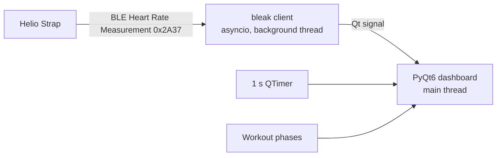

# heliostrap-workout-buddy

A desktop dashboard that reads live heart rate from an Amazfit Helio Strap over Bluetooth and coaches you through an interval workout by heart-rate zone.

## The problem

The Helio Strap has no screen. During an interval session I want one glance to tell me which phase I'm in, how long is left, and whether my heart rate is under, in or over the target for that phase. The phone app shows the number but knows nothing about my plan.

## What I built

A PyQt6 window that finds the strap, subscribes to its heart rate and runs a 40 minute, 11 phase workout (warm-up, aerobic blocks, recoveries, cardio surges, cool-down).

- A large BPM ring that turns blue when you are under the target zone, green when in it, red when over
- Current phase, target range, countdown and progress bar
- Total elapsed and remaining time
- The workout clock starts on the first heart rate reading, not when the window opens

## Architecture



One file, `heliostrap-workout-buddy.py`. The workout is a list of `WorkoutPhase(name, description, duration, bpm_low, bpm_high)` at the top, so changing the plan is editing that list.

## Design decisions

- The standard Bluetooth Heart Rate Service instead of anything Amazfit-specific. Any strap or watch that broadcasts heart rate works, and there is no vendor protocol to reverse engineer.
- Two event loops, kept apart. Qt owns the main thread and bleak's asyncio loop runs in a daemon thread. Readings cross over as Qt signals, which are thread safe, so the UI never touches BLE state.
- The parser handles both 8-bit and 16-bit heart rate values by checking the flags byte, as the spec requires.
- The phase is computed from elapsed seconds every tick, not stored as state. There is nothing to get out of sync if a tick is late.
- Auto-discovery by device name (helio, amazfit, zepp), with `--address` to skip the 12 second scan.

## Setup

```bash
python3 -m venv .venv && .venv/bin/pip install -r requirements.txt
```

The strap has to be broadcasting heart rate over Bluetooth. Turn on heart rate broadcast for it in the Zepp app, and allow Bluetooth for your terminal when macOS asks.

## Run

```bash
.venv/bin/python heliostrap-workout-buddy.py
```

Or connect directly:

```bash
.venv/bin/python heliostrap-workout-buddy.py --address AA:BB:CC:DD:EE:FF
```

## Next

- Load workouts from a file
- Log the session to CSV
- Audio cue on phase change
